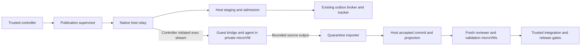

# Docker Sandboxes implementation plan for Startup Factory

Date: 16 November 2026

Status: Implementation and qualification review. The opt-in launcher, persistent native custody service, independent watchdog, external broker relay, raw source/import, fresh review and exact-tree validation paths are implemented. Real mountless-VM smoke and exec framing checks passed; dedicated-account live qualification and real model execution remain unproven. Default execution is unchanged. Docker jobs refuse dispatch without an exact root-issued enrollment and never fall back to host execution. Current operational instructions are in reference/docker-sandboxes.md and reference/docker-sandboxes-deployment.md.

Source baseline: `87b7c731422cc40587de10aea3aa6a694695b392`, Startup Factory 0.2.4. Existing unrelated worktree files are outside this plan.

## Outcome and scope

Run each agent generation in a new local Docker Sandbox microVM. Keep the controller, publication signing, tracker credentials, canonical repository, integration transactions, and release authority on the trusted host. Move repository builds, tests, and recovery validation into explicit disposable validation sandboxes.

The first supported profile is local Docker Sandboxes, using the standalone `sbx` CLI. Support Apple Silicon macOS and a qualification-tested Linux/KVM configuration separately. Docker cloud sandboxes, native Windows, arbitrary host MCP servers, shared writable caches, sandbox reuse across attempts, and interactive host integrations are deferred.

The first implementation uses mountless sandboxes and bounded input/output transfer. It retains broker-owned host worktrees as projections for existing review and integration logic. Workers never mount those worktrees. This reduces migration risk without exposing shared Git authority to agents.

Source history beyond the approved base, Git LFS hydration, submodule updates, newly created or modified symlinks, and unusual filesystem types require explicit later support. Unsupported inputs fail preflight with a specific explanation; they do not trigger direct mounts or unsandboxed execution.

## Security contract

Assume the agent, repository, dependencies, all processes inside a microVM, and guest root can be hostile. A guest helper is a transport convenience; its output carries no authority. The trusted computing base is the host OS, Docker hypervisor/daemon/proxy, protected Startup Factory installation, native relay, broker, source exporter, and artifact importer. Host administrators and physical/hardware side-channel attacks are outside this profile.

The following invariants are mandatory:

1. An agent can access only its approved runtime image, assigned source input, private Git repository, guest HOME, temporary files, caches, and explicitly brokered data.
2. Each implementation attempt and each gate-role generation has a separate VM. Each independent review package and validation run receives a fresh VM. No VM crosses a role, project, attempt, or trust boundary.
3. No host project mount, host home/keychain mount, host Docker socket, SSH agent forwarding, shared skills store, kit host directory, or persistent/shared kit volume reaches a worker.
4. Only the host can select policy, create or identify a VM, grant service access, stage a publication, import code, change protected refs, or authorize release.
5. A sandbox name is a locator, never identity. Protected state binds the backend object identity and creation identity to a unique generation. Operations require either a qualified atomic object-bound interface or a qualified exclusive controller namespace that prevents the locator from ever naming a successor. Names are never reused by Startup Factory, including after failed or uncertain creation.
6. Publication is fenced before cancellation or restart. Killing an `sbx` process does not establish that the guest stopped.
7. Repository code never executes in the host process that owns integration, tracker, approval, or release authority.
8. Missing policy evidence, an unknown runtime version, failed identity inspection, or incomplete cleanup stops new dispatch. There is no automatic fallback to native execution.
9. Reviews and validation bind the exact host-accepted commit/tree, input package, policy, and image identities. Worker assertions and successful unit tests do not certify containment.

Docker documents a separate kernel per sandbox and host-mediated networking. It also exposes integrations outside the VM, so mountless operation alone does not establish this contract. [Docker isolation](https://docs.docker.com/ai/sandboxes/security/isolation/)

## Current integration constraints

| Existing component | Consequence for the implementation |
|---|---|
| `bin/launch-team.sh:1719`, `config/team.config.md:167` | Enforced launches already call a protected external runner. Preserve that trust check and add a versioned Docker execution contract. |
| `bin/publication-supervisor.py:475` and `:521` | Native peer authentication requires stable PID identity, matching UID, and ancestry. A VM process cannot satisfy it directly. |
| `bin/submit-artifact.sh:91`, `bin/runtime-event.sh:93` | Current clients require shared Git-common identity and write host workspace paths. Add guest clients with host ingestion. |
| `bin/runtime-state.py:1447`, `bin/dispatch-plan.py:182`, `bin/worker-control.py:809` | Execution records assume an exact host worktree. Centralize validation before adding backend-aware records. |
| `bin/process-lifecycle.py:364` | Existing lifecycle records represent local PID/session/tmux identities. Add sandbox identity and cleanup state without removing native process checks. |
| `bin/integrate-task.sh:325`, `bin/recovery_validation.py` | Validation needs an explicit backend job, independent of the integrator's outer launch environment. |
| `bin/launch-team.sh:241`, `src/startup_factory_cli/machine_setup.py:305` | Existing HOME is project-wide. Docker workers require private guest state and separate credential provisioning. |
| `src/startup_factory_cli/machine_setup.py:345` | Host absolute CLI/Node paths are unsuitable inside Linux guests. Separate host discovery from image-pinned guest executables. |
| `bin/task-hold.py`, `bin/quarantine-attempt.py` | An unavailable VM must never be interpreted as an absent, therefore clean, host worktree. |

## Proposed architecture



The publication supervisor launches the trusted relay as its native child. The relay satisfies existing Unix-peer, UID, PID-generation, and ancestry checks. It owns the control connection to one exact sandbox and translates guest messages into narrowly scoped host operations. No supervisor socket or outbox signing secret is placed in the VM.

Use non-TTY `sbx exec -i` stdin/stdout as the initial transport candidate. Start a fixed guest bridge that keeps its framed protocol separate from agent stdout/stderr. Capture agent logs as bounded data. Treat every protocol byte as attacker-controlled even when it originates in the shipped helper. Docker documents stdin and foreground execution; framing, buffering, boot output, reconnect, and cancellation require qualification. [Exec interface](https://docs.docker.com/reference/cli/sbx/exec/)

The MVP has no host HTTP listener or guest-accessible generic RPC server. If exec-stream behavior fails qualification, stop this design milestone and specify a separately reviewed transport. Do not replace native provenance with a shared bearer token.

## Phase 0 Docker qualification

Complete these spikes before implementation branches depend on an assumed capability. Their evidence is the first deliverable.

| Spike | Required evidence | Decision on failure |
|---|---|---|
| Version and platform | Pin an exact CLI/daemon release, installation checksums, hypervisor requirements, and structured-output fixtures on each supported platform. | Exclude the platform/version combination. |
| Mountless startup | Create a sandbox with a preapproved kit, no host workspace, skills disabled, no static/dynamic MCP exposure, and no kit volumes. Inspect actual resources before source or credentials enter. | Block the Docker profile. |
| No startup egress gap | Establish deny-by-default policy before kit setup or any guest command. Verify effective policy with a controlled blocked destination and allowed fixture service. | Block execution; setting policy after agent startup is insufficient. |
| Object identity | Qualify either atomic object-bound operations or the exclusive controller namespace defined below. Prove the selected binding across create/inspect/exec/stop/remove, daemon restart, concurrent controllers, failed creates, delayed commands, and name-replacement scenarios. | Block autonomous dispatch until one complete identity model passes; pre/post inspection alone cannot close a replacement race. |
| Factory profile enrollment | Verify the dedicated OS account, daemon identity and every control endpoint, effective settings/credentials, protected namespace ownership, controller lock/epoch, and durable identity registry. Guests and ordinary operators must lack direct daemon access. | A personal-account or alternate app-name experiment cannot satisfy production enrollment. |
| Exec protocol | Non-TTY stdin/stdout preserves frames and backpressure; stderr is distinct; slow readers, disconnects, exit codes, and cancellation are bounded. | Redesign transport before continuing. |
| Resource limits | Establish actual CPU, RAM, VM root/workspace/Docker disk bounds and host metadata/log limits; confirm behavior with guest root. | Keep autonomous mode disabled for any unbounded resource that can exhaust the host. |
| Cancellation and orphan cleanup | Stop/remove the exact VM after relay failure, controller failure, timeout, and daemon restart; confirm no guest descendants or published ports remain. | Block autonomous mode. |
| Credentials | Demonstrate per-sandbox model access, no plaintext guest token, and no global tracker/GitHub/production credential fallback. | Use a separately scoped model broker or block authentication for that profile. |

Qualification candidate: `sbx` v0.54.0 or a later explicitly qualified patch. Version 0.54.0 changes clone-mode Git transport to a user-restricted daemon socket. Keep `clone.legacyTcpRemote=false` even though this design does not use clone mode. [Official release](https://github.com/docker/sbx-releases/releases/tag/v0.54.0)

Local `sbx create` documents `--cpus`, `--memory`, `--skills`, and `--static-mcp`; TTL controls are cloud-only. The controller therefore owns deadlines and cleanup. Use structured output with a pinned schema, because Docker changed output formats in v0.48.0. [Create interface](https://docs.docker.com/reference/cli/sbx/create/), [automation interface](https://docs.docker.com/ai/sandboxes/workflows/automation/)

Do not invent a local `--disk` or `--ttl` flag. Qualify root/workspace storage sizing separately from Docker-volume sizing, including sparse-image growth and storage retained after removal.

### Observed local behavior and identity alternatives

Initial local `sbx` v0.54.0 experiments successfully created two mountless VMs from a pinned shell-kit digest, inspected no host/runtime mounts and an empty static MCP set, exercised private-file canaries and non-TTY exec fixtures, and removed both VMs. UUID-only `sbx inspect` and `sbx exec` selectors were rejected by this installation; UUID-only exec returned status 125. These observations establish particular runtime behaviors, not full containment qualification or a production identity model.

Two identity models are acceptable, each requiring its own enrollment evidence and real-backend tests:

1. **Atomic object binding.** A qualified daemon interface binds each operation to the expected immutable backend ID and creation identity. Deletion, name replacement, or stale generation selection cannot redirect that operation to another object.
2. **Exclusive controller namespace.** A dedicated OS service account and its daemon are controlled only by the trusted factory controller. Every daemon/control endpoint, including alternate sockets or local network listeners, is inaccessible to guests and ordinary operators. All programs able to use those endpoints are part of the trusted host computing base. Personal CLI/UI clients, independent maintenance scripts, automatic environment adoption/creation, and other namespace writers are excluded. The controller uses a protected common lock and fenced controller epochs across creation, inspection, exec dispatch, recovery, stop, and destruction. Long-lived sessions remain bound to their generation; queued commands from a retired generation or controller epoch cannot run.

For the exclusive namespace model, reserve a cryptographically random, normalized name durably before creation and never reuse it. Preserve reservations/tombstones for every outcome, including failure, uncertain completion, cleanup, crash recovery, and controller restart. Bind the observed backend ID and creation identity to that reservation in protected state. Inspection mismatch or missing identity fences the generation and blocks operation; recovery never adopts a replacement because its name matches. Count tombstone storage against the host metadata budget and stop allocation when the budget is exhausted rather than discarding name history.

The exclusive model is safe because only the trusted controller can mutate the namespace and no name can acquire a successor. Inspection verifies that immutable binding; inspection before or after a command is not the control that prevents replacement. The controller lock coordinates trusted clients, but cannot constrain a separate program with direct daemon access. Any such ordinary-operator or untrusted-program access invalidates enrollment. Host administrators remain trusted under this threat model; an administrative override or daemon/account reset invalidates prior qualification and requires reconciliation before dispatch resumes.

The current personal-account `--app-name` experiment does not establish dedicated OS-account isolation, exclusive endpoint access, durable name history, or controller ownership. Autonomous execution remains blocked until a complete identity model and the remaining Phase 0 gates are proven. The two-VM canary/exec results must not be promoted into a passing enrollment or containment receipt.

## Phase 1 Backend contracts and protected configuration

Introduce a small host-only backend interface, with the legacy protected runner retained as its existing backend:

```text
probe(profile) -> capability report
create(launch_spec) -> backend identity
inspect(identity) -> observed identity and state
open_session(identity, guest_argv) -> bounded stream
stage_input(identity, approved_manifest) -> input receipt
collect_output(identity, export_request) -> quarantine receipt
stop(identity) -> observed stopped state
destroy(identity) -> observed removal receipt
```

These are proposed Python interfaces, not Docker subcommands. Call the CLI through absolute, protected executable paths and literal argument arrays. No guest field becomes a CLI option, shell fragment, host command, daemon endpoint, policy selector, or host path. Never discover `sbx` through a project-controlled PATH.

Proposed files:

- `bin/execution_backend.py`: common launch, identity, state, and error types.
- `bin/docker_sandbox_backend.py`: qualified `sbx` adapter and output parsers.
- `bin/execution_descriptor.py`: shared validation for execution records.
- `bin/host_git.py`: fixed-environment Git operations that cannot invoke repository-provided programs.
- `config/sandbox.config.example.json`: non-secret project profile example.
- `config/sandbox.schema.json`: closed profile schema.
- `sandbox/runner/`: source and installation manifest for the protected external runner.

Add proposed team settings `AGENT_EXECUTION_BACKEND=protected-runner|docker-sandboxes` and `AGENT_SANDBOX_PROFILE=<profile-id>`. Existing `AGENT_SANDBOX_ENFORCED` and `AGENT_SANDBOX_RUNNER` remain required for enforced execution. The runner dispatches using a host-fixed backend context; it never selects policy from worker-controlled environment values.

The trusted launcher creates the protected launch specification and passes an already-open read-only descriptor to the runner/relay. The descriptor and host control environment never enter the guest. For the Docker backend, the existing `--workdir ... -- argv...` payload describes guest work; the runner must never execute that agent/setup payload on the host or treat the host workdir as an implied mount. Construct the guest environment and command separately from the relay's minimal host environment.

Separate project-requested settings from the enrolled host policy. A repository can request a profile or stricter limits, but cannot increase permissions. Store the enrolled policy, approved image/kit digests, runtime allowlist, and daemon identity outside agent-writable paths. Bind their digests into every launch record.

Install the executable, interpreter dependencies, and trust-bearing policy under the canonical ownership rules already used for the external runner. Root owns those installations; the service executes as an unprivileged dedicated factory account. Keep the supervisor and relay under the UID required by native publication authentication.

Use a dedicated factory account/daemon configuration. Do not change a developer's personal Docker Sandboxes global policy or credential store implicitly. Enrollment must inspect effective settings, including daemon environment overrides, and recheck after restart. Record the selected qualified identity model and its enrollment evidence digest in the protected profile and each launch. An alternate app name or relocated state directory alone does not prove separate OS credentials or exclusive daemon access.

## Phase 2 Per-agent environments and input transfer

Build a pinned Linux image and approved kit per required toolchain family. Include Git, Python, supported agent CLIs, the Startup Factory guest clients, and the guest bridge. Record image, kit, bridge, toolchain, and configuration digests. No runtime download of an unpinned agent installer.

Validate inherited kit configuration. Allow no kit host mounts or persistent/shared volumes. Docker documents that kit data can outlive sandbox removal, so destruction of the VM alone cannot certify cleanup for arbitrary kits. [Kit data and host directories](https://docs.docker.com/ai/sandboxes/customize/use-kits/#kit-data-and-host-directories)

Use a fixed guest layout:

```text
/workspace/project    private repository for this generation
/opt/startup-factory  image-provided tools
/run/startup-factory  local guest transport endpoint and non-secret context
/home/agent           private CLI state
/tmp                  private temporary files
```

The guest may modify its environment; host authorization never depends on these files remaining truthful.

Implement source export in proposed `bin/sandbox_source.py`, output acceptance in `bin/sandbox_artifacts.py`, and independent cleanup in `bin/sandbox-watchdog.py`.

Provision each launch as follows:

1. Reserve a unique generation and opaque never-reused sandbox name in protected host state.
2. Create the mountless VM under the enrolled deny-by-default policy. Disable shared skills and host MCP integration explicitly.
3. Inspect the backend identity, mounts/volumes, resource limits, effective settings, ports, and policy. Remain unauthorized while provisioning.
4. Export the exact approved source tree using trusted host code. Exclude host Git configuration/hooks, broker metadata, ignored/untracked files, ambient HOME, and credentials. Fail if required tracked source would expose prohibited secrets; do not silently change the source tree.
5. Stream a bounded input manifest and bytes. Initialize an independent shallow private Git repository pinned to the approved source commit, with no alternates, credential remotes, host hooks, external filters, or implicit lazy fetch. Prove exact commit/tree identity in the qualification fixture. If preserving the source commit needs extra objects, authorize that finite object set explicitly.
6. Supply trusted requirements, assigned task packet, and role-scoped board/mailbox projections separately from source. Treat their substantive content as untrusted data.
7. Enable permitted dependency mirror access and run `WORKTREE_SETUP` inside the VM. Dependency lifecycle scripts receive the full sandbox restrictions. Attach only the role's required model credential binding after setup; validation jobs receive none.
8. Activate the generation only after setup and required readiness checks succeed. Start the agent with a minimal explicit guest environment.

Every role gets private HOME, caches, sessions, and temporary files. The controller renders `{prompt_file}` using a guest path; it never embeds a host prompt path or host binary path into the guest command.

Gate agents receive bounded read projections and exact task/review packages. They do not receive the whole writable host `.teamwork` directory. The LLM integrator proposes permitted actions to a deterministic host integration executor; it cannot run that privileged executor as its own guest shell command.

Replace direct tracker reads and shared mailbox access with typed broker requests for authorized task context, role mailbox polling, and acknowledgments. Filter by project/feature/task and role, cap response size, apply the existing content scanner, and record the source revision. Agents never receive tracker authentication merely to preserve polling behavior.

## Phase 3 Broker relay and guest clients

Proposed files:

- `bin/sandbox-relay.py`: trusted native child of the publication supervisor.
- `bin/sandbox_guest_bridge.py`: guest-only framing and local request adapter.
- `bin/sandbox_guest_client.py`: guest submission, event, context, and mailbox client.
- `bin/sandbox_ingest.py`: host envelope construction, staging, and replay checks.
- `config/sandbox-transport.schema.json`: closed, versioned transport messages.

A relay session is host-bound to `{projectId, team, featureId, role, taskId, attempt, generationId, sandboxIdentity, baseCommit, policyDigest, imageDigest}`. The guest receives a non-secret session identifier. Host session state supplies authority; guest identity fields are either omitted or checked only as assertions.

The first protocol exposes a small allowlist:

| Operation | Host behavior |
|---|---|
| `context.read`, `mailbox.poll`, `mailbox.ack` | Return or acknowledge only preauthorized scope and revision. No arbitrary tracker queries or paths. |
| `heartbeat`, `progress`, `runtime.event` | Write bounded, host-timestamped projections. Liveness data never authorizes publication or integration. |
| `artifact.submit` | Receive typed body bytes, validate role/marker/target rules, assign a host entry/body location, then request existing signing/admission. |
| `checkpoint.export` | Collect a bounded code manifest and return a host acceptance receipt. No host ref/path selected by the worker. |
| `integration.prepare`, `integration.resume` | Permit only the integrator role to request the existing host authorization transaction for an exact task/attempt, accepted receipt, current reviews, and prepared intent. No arbitrary ref or merge command. |
| `control.propose` | Accept only explicitly supported role-specific proposals through existing worker-control authorization. No generic restart, merge, release, or shell execution. |

Transport messages carry a protocol version, request ID, operation, and bounded payload. Use strict JSON with duplicate-key rejection, a fixed maximum frame, bounded nesting/strings, rate limits, per-frame monotonic deadlines, and bounded outstanding requests. Use separate chunk frames for large code files. Start with the existing 64 KiB publication-body limit and retain existing request limits where applicable.

Agent logs, stderr, and terminal escapes never become control frames. A log flood cannot starve revocation, cancellation, or controller health. Pause or terminate a flooding session after its budget is exhausted.

For `artifact.submit`:

1. Resolve scope from the protected session and revalidate active generation, holds, role/action authorization, and expiry.
2. Before signing, atomically journal the request ID, payload digest, stable host entry ID/body path, and pending envelope in protected storage. Serialize concurrent requests for the same key. Receive bytes into host-assigned staging. Reject any guest host-path, pre-signed envelope, extra field, or authority override.
3. Construct the existing closed producer envelope and request signing through the authenticated local supervisor. Preserve peer authentication and `sign_active_entry` checks.
4. Let the existing broker copy and validate its immutable admitted package. A guest acknowledgment reports durable admission, not successful tracker delivery.
5. Persist the admission result in that journal before acknowledgment. After a crash between signing/admission and journal completion, resolve the exact existing immutable admission using the stable envelope and bytes. Never allocate a replacement ID/path for an uncertain request. Identical retry returns the same receipt; reusing an ID with different bytes fails.

Preserve the existing recovery rule in `outbox_capability.py`: a package durably admitted before revocation may complete its exact idempotent delivery afterward. Revocation denies new admissions and changed packages; it does not discard already-admitted work.

Do not broaden `publication-supervisor.py` to accept VM PID claims. The authenticated actor is the trusted relay bound to the protected sandbox generation.

## Phase 4 Artifact import and independent review

Choose a constrained manifest plus regular-file bytes for the first output format. Do not import guest `.git`, arbitrary archives, hooks, remotes, packs, Git configuration, or alternate object paths. Guest commits are checkpoints; the accepted host commit is created by the importer and becomes the workflow's authoritative code identity.

An export declares the approved base commit, export ID, claimed resulting tree, and a bounded list of additions, replacements, and deletions. Each file entry includes a normalized repository-relative path, allowed Git mode, byte count, and content digest. The host computes all hashes and resulting tree independently.

Importer requirements:

- Freeze the exported checkpoint or collect an immutable manifest/content set. Reject missing, changing, truncated, duplicate, or oversized content.
- Enforce per-file, file-count, cumulative-byte, path-length, and total-output limits while streaming.
- Reject absolute/traversal paths, NUL/control characters, `.git` components, reserved control paths, case/normalization collisions, and new/modified symlinks or submodules in the MVP. Support binary regular files explicitly.
- Stage through exclusive, no-follow, directory-relative operations. Promote only verified regular files with one link; never recurse over an arbitrary guest directory.
- Apply the declared change set to the exact protected base in a broker-owned projection. Disable Git hooks, external filters, pagers, replace refs, credential helpers, and network-backed object resolution in importer operations.
- Recompute the complete tree and create a host-owned accepted commit. Record the guest checkpoint as provenance only. Return the accepted commit/tree and export digest to the worker.
- Treat collection as unauthoritative quarantine staging. Final promotion runs under the task/authority lock: recheck generation, holds, task lane, attempt, approved base, and expected host projection head. Compare-and-swap only the assigned ref and durably bind its acceptance receipt in a recoverable transaction. Revocation during collection prevents subsequent promotion. Export IDs use the same pre-journaled stable-identity and crash-recovery rules as publication requests.
- Preserve sensitive source changes for independent review; code file names alone do not make CI/config changes safe. Never execute changed CI, IDE, hook, or agent configuration on the host.

Update `review-package.sh`, `delivery_profile.py`, `review_evidence.py`, `process-outbox.sh`, `broker_evidence.py`, and artifact markers together to produce and verify the host acceptance receipt and reviewer sandbox provenance. An old guest-head assertion cannot satisfy a host-commit gate.

Route host import, diff, commit, review, and merge operations through `host_git.py` with a fixed environment and trusted configuration. Ignore ambient/system/global Git configuration and untrusted templates; disable hooks, fsmonitor, external diff/merge drivers, filters, signing helpers, replacement objects, and protocol fetches. Handle repository attributes as untrusted data. A patch modifying `.gitattributes` must not trigger an external program during host merge or checkout.

Each reviewer receives a fresh VM with the exact accepted commit, trusted acceptance criteria, and a bounded evidence projection. No builder session, HOME, skills store, dependency cache, writable volume, or model conversation is reused. Any later export creates a new package and invalidates earlier approval through the existing review-binding logic.

For the MVP, serialize fresh review VM sessions within each existing concrete reviewer-role capability lane. Mint a new capability bound to that VM generation and accepted package; do not publish through a persistent unrelated gate agent. A second same-role session must wait until the first is completed and fenced, because current role lanes supersede earlier capabilities. Preserve distinct-role and independent-context checks in `review_evidence.py`. Parallel review across distinct authorized roles remains available.

## Phase 5 Validation and trusted integration

Split integration into a host transaction and one or more isolated execution jobs:

1. Host code verifies claims, accepted artifact, current review package, and current approval bindings.
2. Host code prepares the exact candidate merge/tree without invoking repository-controlled hooks or programs.
3. A new validation VM receives that exact candidate and the configured checks. Run setup/build/test/lint/format inside it with no model, tracker, release, SSH, or cloud credentials. Use restricted network or pre-provisioned dependencies.
4. The host observes command identities, exit status, timeout, output bounds, policy/image/input digests, and cleanup. Store a validation receipt. Test results remain evidence about those checks, not a proof that all application behavior is safe.
5. Host integration rechecks that base, candidate, reviews, policy, and authorizations still match before advancing the protected feature ref. A changed base requires a new candidate and validation.
6. Run recovery/revert validation through the same job interface. Release builds that execute project code also require a separate execution boundary.

Proposed new component: `bin/validation_job.py`. Adapt `integrate-task.sh`, `recovery_validation.py`, `finalize-integrations.sh`, `release-feature.py`, and relevant delivery attestors. Keep production approval and automatic-release rules unchanged; Docker support does not grant production authorization.

## Phase 6 Lifecycle and recovery

Use protected execution schema v2 and a new versioned lifecycle record. Keep legacy schemas valid only for the legacy backend; never infer a Docker identity from an old record or workspace marker.

The protected record includes backend kind, backend ID/creation identity, opaque unique name, qualified identity model and enrollment digest, controller epoch, generation, native supervisor/relay process identities, role/task/attempt, approved base, guest workspace, host projection, input/image/kit/policy digests, deadline, last inspection, export receipts, publication fence, and cleanup state. Keep permanent name reservations/tombstones separately from active resource reservations. Workspace JSON remains a non-authoritative projection.

Centralize validation in `execution_descriptor.py`; migrate `runtime-state.py`, `dispatch-plan.py`, `worker-control.py`, and the embedded validators in `integrate-task.sh`, `finalize-integrations.sh`, and `process-outbox.sh` together. Retain `worktree` as the broker-owned host projection path; represent the guest workspace separately. Use a tagged identity type so a host path cannot accidentally stand in for a guest workspace or backend identity. Version execution digests, prepared intents, and integration transactions consistently; test recovery and legacy compatibility across those consumers.

Proposed internal states:

```text
allocated -> provisioning -> ready -> running -> collecting -> work-complete
any allocated VM -> fenced -> stopping -> stopped -> removing -> removed
inspection/cleanup uncertainty -> cleanup-pending or lost
```

These are runtime states, not new tracker statuses. A cleanup-pending/lost attempt cannot publish or release its resource reservation. A lost VM/export is unknown work, never an implicitly clean worktree.

Successful completion also enters the fence/stop/remove sequence after bounded final export and durable publication admission. `work-complete` records the work outcome; it does not exempt the VM, credentials, ports, or storage from cleanup. Release reservations only after confirmed removal, on success as well as failure.

Cancellation order:

1. Atomically fence/revoke new publication and control admission for the exact generation.
2. Stop accepting new guest requests; cancel queued non-admitted requests and close the relay session.
3. Stop the exact VM through the qualified atomic-object or exclusive-namespace identity binding. If needed, use only qualified escalation controls.
4. Preserve the last already-accepted checkpoint and bounded, sanitized host logs. The MVP guarantees durability only for accepted checkpoints, not in-progress guest edits. It performs no new guest execution or post-stop salvage during cancellation.
5. Remove the VM and its owned ephemeral resources; verify removal, secret binding cleanup, port cleanup, and storage accounting.
6. Retire lifecycle state and free reservations only after confirmation. A replacement receives a new generation and VM.

Do not invoke `sbx exec` on a retired or fenced VM: exec can restart a stopped sandbox. Normal checkpoint collection occurs before cancellation. Future salvage requires a separately qualified non-starting interface.

Install a host service/watchdog independent of the relay, plus startup reconciliation. It reads only protected ownership records, fences orphaned generations, inspects exact backend identities, and cleans up registered resources. It never prunes by name prefix or deletes an unregistered sandbox. Atomic launch intent records allow recovery after a crash between VM creation and normal registration; unmatched resources require identity-verified reconciliation.

If cleanup remains uncertain, deny further launches in the affected factory resource pool and show actionable status. During a complete host shutdown guests are not executing; on recovery, reconcile before enabling dispatch.

## Network credentials and resource policy

All settings below belong to the dedicated factory profile. Enrollment must verify effective values and reject incompatible overrides.

| Area | Required policy |
|---|---|
| Workspace and kits | Mountless; skills off; no inherited host mounts, persistent volumes, host commands, repository `sbxenv.yaml`, or unapproved kit mixins. |
| Host integrations | Disable SSH agent forwarding, host browser opening, browser-control integrations, clipboard integrations where supported, automatic ports, static/dynamic host MCP, and remote-control features. |
| Network | Default deny before creation; scoped provider endpoints and approved mirrors only; explicitly test DNS, TCP, UDP, IPv4/IPv6, host/LAN/link-local/metadata routes, and siblings. No guest-triggered policy approvals. |
| Credentials | Scoped model credentials or a constrained model gateway only. No tracker/GitHub write/deploy token, bulk secret import, personal HOME/keychain forwarding, or global privileged-service fallback. |
| CPU and memory | Explicit VM allocation and aggregate admission reservation; reserve controller headroom. Guest process limits are supplementary because guest root can alter them. |
| Disk and output | Qualified host-enforced VM disk caps plus bounded controller metadata, input, output, logs, and staging. Account for sparse allocation and retained resources. No shared writable package or Docker caches. |
| Time and cost | Controller wall-clock deadlines and independent cleanup watchdog. Enforce model spending/request limits through provider-scoped quotas or a budget-enforcing gateway; hiding an API key does not limit its use. |

Docker's host settings control SSH forwarding, browser access, and other integrations; some changes require daemon restart and others apply only to new VMs. Record effective settings rather than assuming stored overrides took effect. [Settings](https://docs.docker.com/ai/sandboxes/configuration/settings/)

Docker service secrets are global by default; sandbox-scoped credentials override them. The factory profile must exclude privileged global defaults and OAuth passthrough. Deleting one scoped credential is insufficient if a global credential becomes available. [Credentials](https://docs.docker.com/ai/sandboxes/configuration/credentials/)

An allowed model endpoint receives source context by design. Domain allowlists do not prevent every disclosure through an allowed service or authorize every API action there. Use provider policy, narrow credential scope, and request-level controls when needed. Do not claim complete exfiltration prevention.

Initial tuning targets, subject to workload measurement: 2 vCPUs, 4 GiB RAM, a 30-minute wall-clock deadline, 64 KiB publication bodies, and bounded logs/exports. Resource and output limits are positive finite values in the profile, with stricter role overrides. Autonomous enablement requires measured hard storage limits; a disk-usage poller alone is insufficient.

## Implementation work packages

Use separate reviewable changes with the following dependency order. Proposed files are additions; existing files listed below require scoped edits.

| Package | Main work | Dependencies and completion condition |
|---|---|---|
| 0 Qualification | Add disposable fixture/harness and platform evidence. Record exact Docker commands, schemas, identity semantics, network policy, disks, cleanup, and overhead. | No production credentials. All Phase 0 blockers resolved for at least one platform. |
| 1 Contracts | Add backend/profile/execution schemas and centralized descriptor validation; update config parser consumers. | Package 0. Legacy tests pass; unknown backend/schema rejected. |
| 2 Runtime | Add backend adapter, protected runner install manifest, image/kit, source exporter, and private input provisioning. | Package 1. Two VMs operate independently with no host mounts or shared state. |
| 3 Lifecycle | Extend process lifecycle, worker control, task holds, quarantine, restart policy, health, watchdog, and protected crash journal. | Package 2. Timeout/crash/restart cannot leave live publication authority or misclassify lost work. |
| 4 Broker | Add relay, guest clients, bounded ingest, context/mailbox projections, request retry receipts, and submission/event adapters. | Packages 2–3. Preserve native authentication, scoped admission, supersession, and durable retry behavior. |
| 5 Code and review | Add bounded artifact importer and acceptance receipts; update delivery/review package and runtime evidence bindings. | Package 4. Independent review binds the accepted host commit; cross-task or mutated packages fail. |
| 6 Validation | Add validation jobs and split integration/recovery/release-code execution from trusted host bookkeeping. | Package 5. Complete synthetic delivery and failed/reverted validation fixtures pass. |
| 7 Product readiness | Update setup/login/doctor/PM preflight, guest command rendering, upgrade diagnostics, docs, and bundle contents. | Packages 1–6. Installation and upgrade preserve fail-closed behavior. |
| 8 Containment release | Run real-platform security suites, resource/failure checks, supported CLI/model smoke tests, and a staged opt-in rollout. | Package 7. Every mandatory check below passes with durable evidence. |

Package 7 touches `src/startup_factory_cli/machine_setup.py`, `readiness.py`, installer/updater code, `bin/machine-login.py`, `bin/pm-agent.py`, `bin/beta-readiness.py`, `packaging/bundle-spec.json`, and operational references. Update `reference/guardrails.md` and role instructions to distinguish normal private guest Git operations from prohibited mutation of host Git/broker authority. New source files must enter the release bundle; host provisioning artifacts and approved image publication need separate distribution instructions.

Enforced setup distinguishes host `sbx` discovery from guest agent executable discovery. Keep the existing generic command-template mechanism, but validate guest paths in the approved image. Do not rewrite guest commands to a laptop's Homebrew paths.

## Security validation and release criteria

Use trusted test fixtures and dummy identities/secrets. Run hostile fixtures only within the disposable Docker boundary being qualified on a dedicated test host. Do not probe production endpoints or execute target-controlled tests on the developer host. Keep bounded CPU, RAM, disk, process, output, network, and time limits in every live fixture.

Host-file and credential checks use deliberately planted dummy canaries on the dedicated fixture host. Network checks use isolated fixture services and emulated LAN/metadata endpoints with host-side observation, so a failed policy cannot reach real production infrastructure or retrieve a real credential.

| Area | Mandatory checks | Required result |
|---|---|---|
| Filesystem | Guest root attempts host-home/keychain/broker reads, sibling access, host sockets, mount/config tampering, symlink/hardlink escapes, and kit-volume persistence. | No host/sibling access; only approved guest data is reachable; no shared state persists. |
| Processes | Inspect/signal sibling and host processes; create grandchildren and detached children. | No cross-boundary control; VM stop removes every guest process regardless of process-group behavior. |
| Transport | Duplicate keys, invalid encodings, unknown ops/fields, oversize/truncated/slow frames, stderr contamination, request/log flood, and backpressure. | Bounded memory/time/output; no host command execution; cancellation remains responsive. |
| Authority | Forge role/task/project/attempt, host body path, capability, signer, target status, arbitrary control target, and sandbox selector. | Denied before signing, staging promotion, or external effects. |
| Identity and enrollment | Atomic model: race name replacement against object-bound operations. Exclusive model: deny every control endpoint to guest/ordinary-operator clients; race controller instances; crash before/after create registration; preserve tombstones after every outcome; test stale epochs/queued exec, daemon restore, and identity mismatch without adoption. Verify no independent namespace writer is enrolled. | One complete identity model prevents operations from selecting a successor; missing enrollment evidence blocks dispatch. Inspection alone cannot produce a pass. |
| Generation | Revoke during partial frame/admission; expire/supersede; attempt name reuse; replay from old sessions. | No new admission from a retired generation; names remain reserved; no successor confused with predecessor. |
| Durable retry | Crash at each request-journal, signing, admission, acknowledgment, export-promotion, and receipt boundary; retry concurrently; repeat IDs with same/different bytes; resume exact pre-fence admitted delivery. | Existing immutable effects recover once; uncertain requests never allocate a second envelope/ref update; changed or new stale packages fail. |
| Input and output | Wrong base/tree, binary changes, path traversal, deletion, mode changes, symlinks, submodules, Git hooks/filters/merge drivers, case collisions, size/hash mismatch, and revoke during export. | Only validated regular-file change sets enter the assigned host projection; external Git programs never run on the host; fenced exports cannot promote. |
| Review | Builder modifies output after review, supplies its own approval, attempts reviewer-context access, or shares caches/session state. | Package binding invalidates changed code; reviewer identity and mutable state remain separate. |
| Networking | Blocked DNS names/queries, raw/direct TCP, UDP, IPv4/IPv6, redirects, host/LAN/metadata/private addresses, sibling services, proxy bypass, and shared-IP policy edge cases. | Observed traffic matches the enrolled policy; no blanket network-isolation claim from a single curl test. |
| Credentials | Read env/files/keychain, exercise SSH signing, invoke a privileged allowed service, remove scoped secret with global fallback, and request OAuth passthrough. | No unintended credential value or authority reaches the guest; factory setup rejects unsafe fallback. |
| Resources | Safe bounded CPU/RAM/process/disk pressure, Docker image growth, huge logs/exports, and model request exhaustion. | Hard caps hold; the host retains enough capacity to revoke, inspect, and clean up. |
| Lifecycle | Agent/relay/controller crash, timeout, normal success, failed create, daemon restart, host restart, missing identity, cleanup failure, and concurrent restart. | Publication fenced; registered VM removed on success and failure; uncertainty blocks new dispatch; unrelated sandboxes untouched. |
| Integration | Candidate base changes, stale review, failing validation, missing receipt, revert failure, and altered policy/image after review. | Integration/release stops or recomputes evidence for the new exact candidate. |
| Compatibility | Each supported agent CLI/toolchain, two concurrent builders, independent reviewer, dependency setup, private mirror, legitimate events, artifact publication, and recovery. | Normal delivery succeeds under the same restrictive policy tested above. |

Split tests into three layers:

1. Deterministic unit/contract tests with a fake `sbx` adapter for parsers, schemas, decisions, retries, and failures. These do not certify isolation.
2. Existing workflow regression suites for launcher/lifecycle, attempts/holds, publication/outbox, review/integration, recovery, setup, upgrade, and packaging. Register new suites in `tests/run-all.sh`.
3. A separate real-Docker containment suite on supported macOS and Linux hosts. Unsupported hosts report an explicit missing capability. A skipped containment suite cannot produce a readiness pass.

Extend relevant existing suites: `launcher-test.sh`, `launch-barrier-test.py`, `process-lifecycle-generation-test.py`, `worker-control-test.py`, `task-hold-test.py`, `claim-lineage-runtime-test.py`, `publication-supervisor-test.py`, `outbox-capability-supersede-test.py`, `broker-evidence-test.py`, `review-evidence-test.py`, `delivery-profile-test.py`, `parallel-integration-test.sh`, `recovery-validation-test.py`, `machine-setup-test.py`, `safe-turbo-readiness-test.py`, and `tests/packaging/*`.

Retain a host-authenticated containment receipt containing platform, Docker CLI/daemon identity, selected identity model and enrollment evidence digest, image/kit/bridge/policy digests, test-suite revision, fixture identities, individual results, and timestamp. Runtime/profile/image or endpoint-ownership changes invalidate prior qualification. Each launch additionally records its own observed configuration and controller epoch. Workspace-authored health or test JSON cannot replace either record.

## Rollout and operational behavior

1. Ship the backend opt-in with autonomous readiness disabled until qualification is complete. Preserve the existing native/protected-runner behavior for already configured users.
2. Run a synthetic local tracker feature through planning, implementation, review, candidate validation, and integration. Use dummy broker credentials and no production release.
3. Run a real non-production project with one implementation agent, then two concurrent agents and independent review. Measure boot/setup/build time, peak host resources, export latency, broker responsiveness, cleanup duration, and retained disk.
4. Enable unattended non-production execution only for enrolled version/platform/profile combinations with all mandatory checks passing.
5. Require existing release attestors to consume exact validation and isolation evidence before any production rollout; keep explicit production authorization rules intact.

Expose `provisioning`, `running`, `collecting`, `fenced`, `cleanup-pending`, and `lost` in host health with actionable reasons. Separate structural configuration checks from live containment qualification and real model authentication checks. Authentication smoke tests may incur provider usage and run only in their designated stage.

On Docker or kit upgrades, stop new dispatch, finish/fence active generations, apply the upgrade, recreate sandboxes, and rerun qualification before resuming. Never resume old VMs under a changed trust policy. Rollback selects an explicitly qualified earlier combination; it does not disable sandboxing.

## Definition of done

- [ ] At least one supported platform has an exact qualified Docker release and reproducible provisioning instructions.
- [ ] Atomic object binding or exclusive controller namespace enrollment passes its complete identity tests; a personal-account app-name experiment or pre/post inspection cannot satisfy this gate.
- [ ] Each agent generation, independent review, and validation job receives its own mountless microVM and private mutable state.
- [ ] Guest-root fixtures cannot reach host authority, sibling state, forwarded credentials, host integrations, or prohibited network routes.
- [ ] Broker publication retains native peer authentication and exact generation/role/task/revocation/admission semantics.
- [ ] Host artifact acceptance and reviewer evidence bind an immutable accepted commit/tree; no guest path or Git configuration enters host authority.
- [ ] Integration, recovery validation, and project-controlled release builds execute outside authority-bearing host processes.
- [ ] Resource limits, independent timeout enforcement, crash recovery, and confirmed removal pass real-backend tests.
- [ ] Doctor and PM preflight refuse unknown versions, missing containment evidence, configuration drift, or unresolved cleanup.
- [ ] Packaging, installation, upgrades, legacy-backend regression checks, and operational documentation pass.
- [ ] A complete non-production delivery with concurrent agents and independent review succeeds under the production-intended isolation policy.

The first engineering milestone is the Phase 0 qualification report and a two-sandbox dummy workflow demonstrating isolated files, a scoped publication through the native relay, revocation, and confirmed cleanup. Its results determine the final command/version profile before broader orchestration changes begin.
